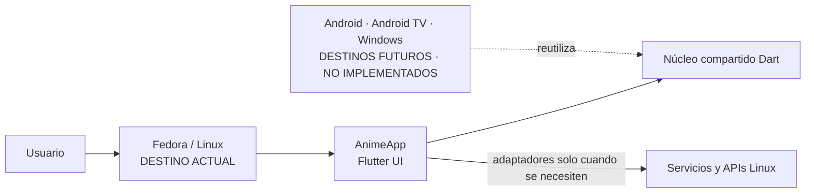
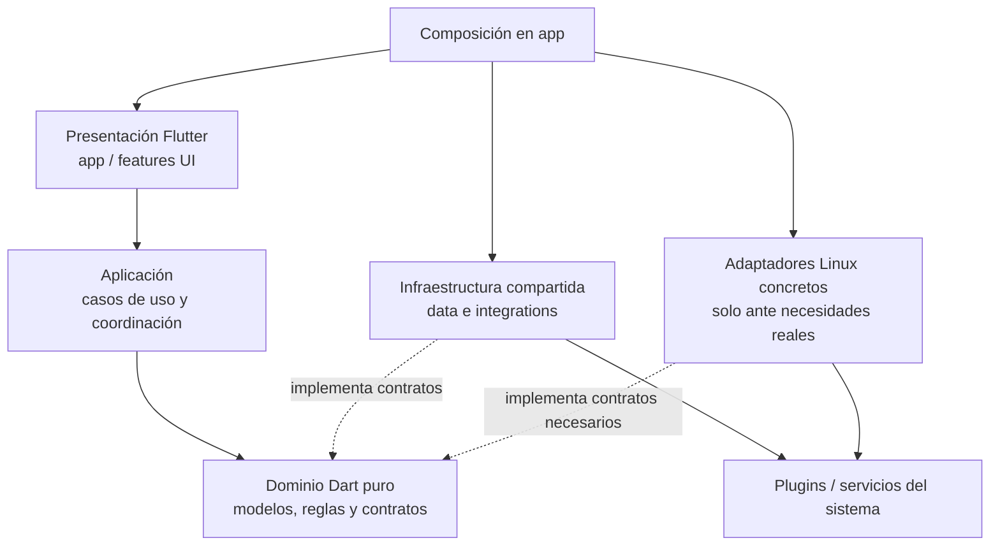
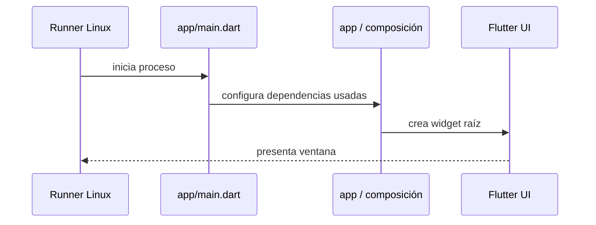
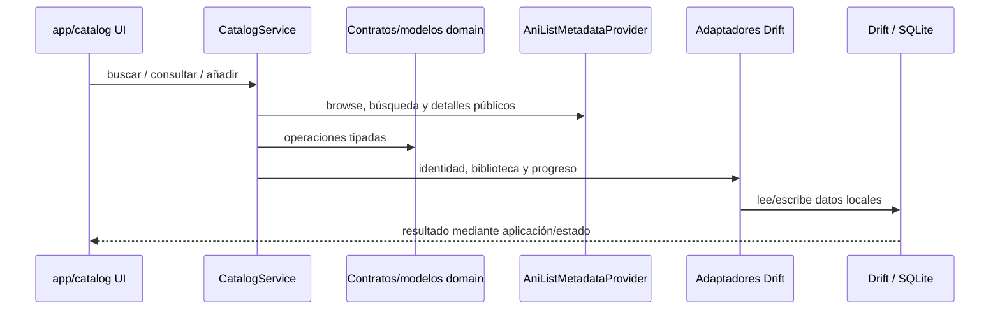
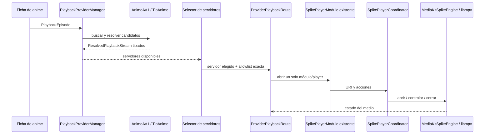

# Arquitectura de AnimeApp

Este documento conserva la arquitectura de referencia aprobada para F1.3 y registra las implementaciones locales posteriores. No todos los módulos conceptuales están implementados: el estado real se indica por módulo y en `PROGRESS.md`. El producto abre [Inicio](app/lib/app/home/README.md) dentro del shell de catálogo. La ficha está conectada a proveedores de reproducción y reutiliza el `SpikePlayerModule`/engine existentes; los streams externos encontrados hasta ahora no han demostrado reproducción exitosa. El progreso del player sigue sin integración.

## Decisión de plataforma

AnimeApp se construirá con un núcleo compartido y Fedora/Linux como primer destino de implementación y validación. Android, Android TV y Windows son destinos futuros. No se crearán ahora código, carpetas, adaptadores, servicios, interfaces ni dependencias específicos de esos destinos. Al incorporarlos se reutilizará el núcleo y se añadirán únicamente las piezas que una necesidad real de la plataforma justifique.

El código general se escribirá en Dart reutilizable cuando sea técnicamente viable. Dominio y aplicación no dependerán de Flutter UI, Linux, plugins ni servicios externos. Flutter se utiliza en las capas de presentación y composición; las APIs del sistema y las bibliotecas concretas quedan en adaptadores. Esto conserva la independencia del dominio sin crear puertos abstractos que aún no tengan consumidor.

## Diagrama de contexto

La línea discontinua indica una dirección de portabilidad futura, no una integración actual.

## Diagrama de capas y dependencias

Las flechas sólidas representan uso/configuración; las discontinuas representan implementación de contratos. El dominio no importa capas externas. La composición de dependencias ocurre en `app`; una feature no importa la UI de otra feature. Los módulos que no tengan responsabilidad real o consumidor no se crean.

## Módulos conceptuales

Estos nombres describen límites de responsabilidad; no ordenan crear de antemano todas las carpetas bajo `app/lib/`.

| Grupo | Responsabilidad y límite | Estado y portabilidad |
| --- | --- | --- |
| `app` | Arranque, composición y selección de implementaciones. | Parcial: bootstrap Flutter, catálogo AniList/SQLite y ruta de proveedores hacia el player existente Linux-first. |
| `application` | Coordinación de casos de uso Dart puros. | Implementado para catálogo; no depende de Flutter, SQL ni HTTP. |
| `domain` | Identidades, modelos, reglas y contratos Dart puros. | Implementado para identidad, catálogo, biblioteca, progreso, credenciales y sincronización. |
| `data` | Adaptadores de persistencia, proveedores y servicios externos. | Implementado para Drift/SQLite y AniList. El composition root de playback registra AnimeHeaven y su resolver MP4; los intentos anteriores AnimeAV1/TioAnime/AnimeGG/Miruro y sus límites se conservan en informes. Ningún episodio externo está acreditado como reproducible. |
| `core` | Tipos y utilidades transversales realmente compartidos; contratos solo cuando haya necesidad concreta. | Implementado para `Result`, errores y logging; no debe convertirse en depósito de funcionalidades. |
| `shared` | Componentes reutilizables por más de una feature, con límites y ciclo de vida propios. | Planificado; crear al aparecer reutilización demostrada. |
| `features` | Recorridos independientes, cada uno con presentación y coordinación propias. | Planificado; lógica de negocio invoca aplicación/dominio y no importa otras UIs. |
| `integrations` | Clientes/adaptadores de AniList, persistencia, sincronización, reproductor y sistemas externos. | Planificado; aislar librerías aprobadas tras sus validaciones por fase. |
| `platform` | Adaptadores de capacidades concretas del sistema operativo. | No hay un framework de plataformas anticipado. En la etapa inicial solo se añade implementación Linux requerida. |
| Runner nativo | Ventana, ciclo de vida y conexión con el host Flutter. | Existe runner Linux en `app/linux`; sus detalles nativos no deben filtrarse al dominio. |

No se separan archivos solo por tamaño o por preferencia: un archivo propio se justifica por responsabilidad, estado/lógica, pruebas, reutilización, frecuencia de cambio o dependencias particulares. Componentes pequeños y cohesionados pueden compartir archivo. No crear carpetas con un único archivo sin motivo.

## Flujos de referencia e implementados

Los diagramas identifican expresamente qué recorrido está implementado y qué límites siguen pendientes.

### Arranque en Linux

Solo se inicializan servicios necesarios para el recorrido disponible. El arranque no debe cargar anticipadamente integraciones pesadas ni iniciar tareas de fondo innecesarias.

### Catálogo y biblioteca (implementación parcial con AniList público y persistencia local)

La composición normal consulta metadata pública AniList sin OAuth y conserva cachés, biblioteca y progreso local en Drift; los tests/widget usan `FakeMetadataProvider` y aíslan SQLite en temporales. `CatalogModule` es dueño del servicio y la base y debe cerrarse al terminar el runtime. Estados y muestras de progreso pueden seguir siendo demostrativos; `streamingEpisodes` son metadata, no URLs reproducibles.

### Reproducción desde la ficha (integrada; fuente remota no validada como reproducible)

La ruta conserva `CatalogHomePage` → `PlaybackProviderManager` → selector → `ProviderPlaybackRoute` → el único `SpikePlayerModule`, `SpikePlayerCoordinator`, `MediaKitSpikeEngine` y `VideoController`. El composition root registra AnimeHeaven y su resolver MP4, pero los tres mirrors publicados (`cx`, `ct`, `ck`) para One Piece ep. 1 fallaron al abrir/decodificar y no presentaron imagen; no hay playback externo confirmado (0/70). El manager no controla libmpv. El entrypoint `main_player_spike.dart` sigue disponible para pruebas locales del motor; la superficie desactiva controles adaptativos y el player se cierra mediante su módulo. La vida nativa completa de `VideoController` aún carece de prueba end-to-end automatizada. Ver el [README de providers](app/lib/data/player/providers/README.md), el [README de AnimeHeaven](app/lib/data/player/providers/animeheaven/README.md), el [README del player](app/lib/app/player/README.md) y el [informe S0](docs/ai-system/missions/S0-REAL-PLAYBACK-REPORT.md).

## Contratos y adaptadores

- Mantener el dominio Dart puro; no importar Flutter, Dio, Drift, Supabase, `media_kit` ni APIs del sistema desde dominio.
- La aplicación coordina casos de uso mediante contratos orientados a capacidades y resultados del negocio.
- Un adaptador se justifica cuando una dependencia externa, almacenamiento, sistema operativo o mecanismo de presentación debe aislarse o sustituirse. Evitar interfaces espejo de cada clase de una biblioteca.
- La capa de composición selecciona adaptadores Linux actuales y conecta implementaciones con contratos.
- Preservar persistencia local-first. Sincronización remota es posterior y no almacena archivos de video.
- El motor multimedia se valida antes de integrarse. `mobile_scanner` queda limitado a Android cuando esa plataforma se emprenda; no se incorpora en la etapa Linux.
- Mantener cancelación, errores tipados, cierre de streams/controladores y liberación de memoria/recursos en el módulo propietario.

## Estructura futura propuesta para F1.4

F1.4 implementará solamente el esqueleto necesario para Linux y los contratos compartidos que correspondan. Esta propuesta es el límite de planificación, no una autorización para adelantar implementaciones de F1.5 en adelante ni para añadir dependencias sin necesidad.

### Conservar como base existente

| Ruta existente | Uso |
| --- | --- |
| `app/lib/main.dart` | Punto de entrada Flutter existente. |
| `app/lib/app/anime_app.dart` | Widget raíz/composición UI existente. |
| `app/lib/domain/app_identity.dart` | Identidad Dart pura existente; mantener libre de imports Flutter. |
| `app/linux/` | Runner Linux generado/actual; modificar solo ante necesidad documentada. |

### Crear en F1.4 solo si los criterios lo justifican

| Ruta candidata | Propósito mínimo |
| --- | --- |
| `app/lib/app/` | Mantener composición/arranque y registro de implementaciones realmente usadas. |
| `app/lib/core/` | Tipos compartidos mínimos con dos o más consumidores o contrato requerido por un caso de uso. |
| `app/lib/domain/` | Modelos/reglas/puertos compartidos solo para requisitos incluidos en el alcance concreto de F1.4. |
| `app/lib/platform/linux/` | Adaptador Linux únicamente si el esqueleto requiere una capacidad del host que no proporciona Flutter directamente. |

No es obligatorio crear todas estas rutas; no crear estructura candidata vacía. `shared/`, `features/`, `integrations/` y adaptadores Android/TV/Windows quedan para fases que implementen responsabilidades reales. Drift, AniList, credenciales, sincronización y reproducción conservan sus subfases, no se adelantan como parte de este diseño. Los límites exactos de F1.4 deben contrastarse con sus criterios y los archivos actuales antes de escribir código.

## Documentación y portabilidad de módulos

Cada módulo importante tendrá un README propio junto con su implementación, no un README vacío anticipado. Incluirá: responsabilidad; arquitectura interna; tabla de archivos y funciones; contratos públicos; dependencias; flujo; estado/ciclo de vida; errores; configuración; pruebas; rendimiento; partes portables; dependencias Linux actuales; procedimiento de portado; riesgos y limitaciones. Actualizarlo con cada cambio relevante sin duplicar la arquitectura general.

Al incorporar una plataforma futura: inventariar dependencias reales, reutilizar dominio/aplicación, definir adaptadores solo ante diferencias demostradas, adaptar UI/controles, probar paridad funcional y medir rendimiento/tamaño. Las diferencias funcionales requieren justificación técnica documentada. No se preparan ahora adaptadores simulados ni servicios futuros.

## Rendimiento, seguridad y distribución

- Medir arranque, memoria, CPU, latencia, fluidez, estabilidad y tamaño en cargas y equipos reproducibles; modularidad y tree shaking no prueban por sí solos eficiencia.
- Inicializar servicios bajo demanda; cancelar trabajo y liberar recursos al terminar. Evitar procesos en segundo plano sin necesidad.
- Revisar permisos mínimos, tratamiento de credenciales y seguridad de Auth/RLS antes de habilitar Supabase. No alojar video en el backend.
- Revisar licencias y compatibilidad de dependencias antes de distribuir. Flatpak permanece como formato Linux principal propuesto; no se configura ni publica un paquete en F1.3.
- Las metas preliminares existentes no son resultados medidos ni presupuestos definitivos. Resultados reales se registran en `docs/perf/`.

## Estado actual de implementación

El catálogo se distribuye por capas: contratos/modelos en `app/lib/domain/catalog`, coordinación en `app/lib/application/catalog`, persistencia en `app/lib/data/local_db`, fake en `app/lib/data/metadata` y UI/composición en `app/lib/app/catalog`. El progreso tipado está en `app/lib/domain/progress` con adaptador en `data/local_db`; el formato opaco legado permanece separado para preservar compatibilidad. Los README de módulo detallan archivos, contratos, dependencias y pruebas.

F2.1 tiene evaluación documental y F2.2 tiene un spike nativo aislado con `media_kit`/libmpv. Las responsabilidades por archivo y los comandos verificados se documentan en los README de los módulos player y en [el informe v2](docs/player/F2.2-spike-report-v2.md). La señal del plugin de textura/primer frame no prueba presentación visual del compositor; en este entorno no se obtuvo captura nativa. El motor no se integra con progreso, catálogo, navegación ni persistencia. Android, Android TV y Windows no están implementados. El estado de F0.4–F0.6 se registra en [PROGRESS.md](PROGRESS.md) y [TESTING.md](TESTING.md).

## Decisión asociada

La estrategia **núcleo compartido + Fedora/Linux primero + adaptadores progresivos por plataforma** fue aprobada por el propietario para F1.3. Su registro independiente, alternativas y consecuencias están en [ADR-015](docs/adr/ADR-015-arquitectura-core-linux-first.md). Las selecciones F1.2 continúan sujetas a sus validaciones técnicas por fase.
