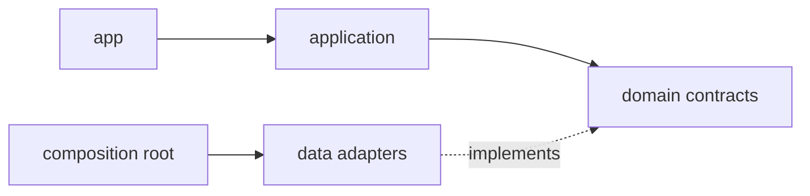

# Capa application

## Propósito

Coordina casos de uso y políticas entre la presentación, contratos de dominio
y adaptadores inyectados. No importa widgets, GTK, SQLite/Drift, media_kit ni
DTOs remotos. La composición bajo `app/` proporciona implementaciones.

## Módulos

| Módulo | Responsabilidad | Dependencias | README |
|---|---|---|---|
| `catalog/` | Caso de uso de búsqueda/detalle del catálogo local | contratos de catálogo y Result | [Catálogo](catalog/README.md) |
| `player/` | Cola de comandos, sesión F2.4, estados, acciones de player y selección de proveedor | contratos de player/providers de dominio | [Sesión](player/README.md) |
| `player/providers/` | Registro, prioridad, fallback, deduplicación y circuit breaker 3/60 | `domain/player/providers` | [Manager](player/providers/README.md) |

## Dirección de dependencias

`app` adapta interacción y composición hacia application; application depende
de puertos/modelos del dominio; `data` implementa puertos. El adaptador de
motor recibe un URI que ya está resuelto y no conoce proveedores. Los
proveedores nunca llaman al motor.

## Pruebas y extensión

Las pruebas de coordinación están en `app/test/application/`, las contract
tests en `app/test/domain/` y las integraciones nativas en `app/test/player/`.
Para añadir un caso de uso, declarar primero su contrato de entrada/salida,
inyectar puertos y cubrir fallos y concurrencia antes de conectarlo a UI.
