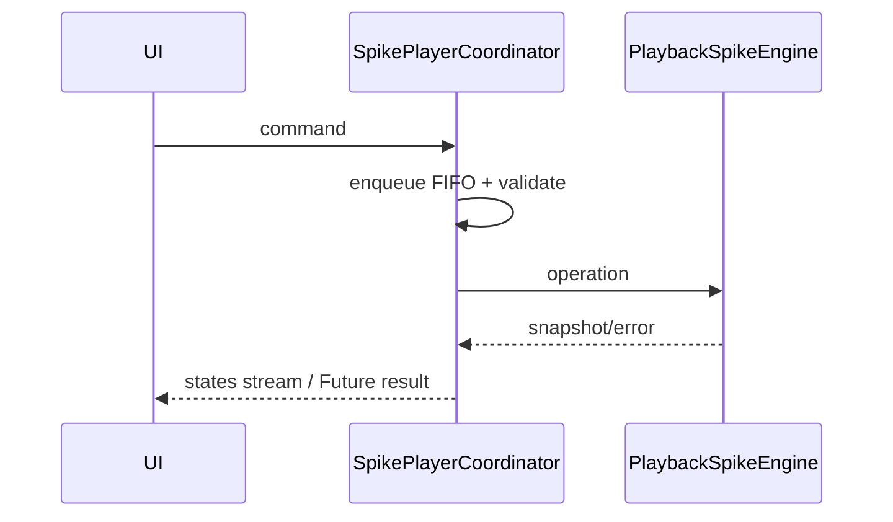

# Coordinación de reproducción F2.4

## Propósito y límites

`SpikePlayerCoordinator` serializa los comandos básicos del spike y publica snapshots observados. Aísla la UI del motor nativo mediante `PlaybackSpikeEngine`. No persiste progreso, no consulta catálogo/biblioteca, no contiene Flutter/media_kit y no constituye el contrato definitivo reservado para F2.5.

## Archivos y contratos

| Archivo | Propósito | Entrada/salida | Dependencias |
|---|---|---|---|
| `playback_spike_contract.dart` | Puerto temporal del motor, capacidad opcional `PlaybackVideoSelection`, contexto HTTP aprobado y snapshot inmutable con pistas de video | URI/comandos → stream de estado | Dart, `VideoTrackInfo`, `PlaybackRequestHeaders` |
| `spike_player_coordinator.dart` | Orden FIFO, selección de pista de video/audio, límites, rollback y cierre | comandos async y `states` | Puerto de este módulo |
| `README.md` | Ciclo de vida, contratos y pruebas | desarrollador → guía | ADR-002, módulos vecinos |

El coordinador debe crearse una vez en el composition root. `initialize()` repetido es idempotente. `dispose()` marca el cierre antes de encolarse detrás de las acciones en curso, comparte su Future entre callers concurrentes y rechaza comandos posteriores cuando se ejecutan. No cancela una operación nativa pendiente: el cierre espera esa operación. `dispose()` cierra el stream público incluso si falla la limpieza del motor y permite reintentar solo etapas que el adaptador declara seguras. Si el dispose nativo queda incierto, el adaptador conserva su lease y la composición no crea otro Player.

`open` valida esquema `file:`; el adaptador valida de forma independiente que sea un archivo local regular existente antes de llamar al motor. `seek` rechaza valores negativos y posiciones posteriores a duración conocida. Las acciones aceptadas se ejecutan en cola FIFO; una operación fallida devuelve su error al llamador sin envenenar la cola. El snapshot distingue `stopped` de `paused`: tras Stop el siguiente `play()` sigue siendo una operación coordinada y el adaptador vuelve a abrir la fuente lógica retenida; tras Pause el motor reanuda el medio cargado. La UI no invoca directamente `Player.open()`. El slider no llama al coordinator desde `onChanged`; la capa de UI entrega el destino final y coalesce los destinos pendientes para evitar acumular seeks interactivos.

## Ciclo de vida y errores

`initialize` llama al puerto y luego escucha snapshots. `open/play/pause/seek/stop` esperan en la cola y propagan errores async. `dispose` cancela la suscripción, dispone el motor incluso si initialize falló (el adaptador puede haber creado recursos antes) y cierra el stream público en todos los casos. Si el motor falla, se propaga el error y un segundo dispose solicita cleanup pendiente; el controller de estados no se reabre. No se usa timeout para fingir cancelación de la operación bloqueada. El coordinador no tiene timers ni persistencia.

## Estado tipado de sesión F2.4

`PlaybackSpikeSnapshot` contiene hechos observados del motor (playing,
buffering, posición, duración, volumen, Stop y error). `PlaybackSessionSnapshot`
los envuelve con el estado de aplicación, `seeking` y una generación lógica de
fuente. La búsqueda es ortogonal: puede estar activa mientras el estado sigue
siendo `playing` o `paused`.

| Estado | Significado | Transición normal |
|---|---|---|
| `idle` | Coordinador listo sin fuente abierta | `open` → `opening` |
| `opening` | Una apertura serializada está pendiente | éxito → `ready`; error → `error` |
| `ready` | Fuente abierta sin iniciar reproducción | Play → `playing` |
| `buffering` | El motor indica buffering | el snapshot del motor determina el siguiente estado |
| `playing` | El motor o el comando confirmado indica reproducción | Pause → `paused`; Stop → `stopped` |
| `paused` | Fuente retenida y reproducción pausada | Play reanuda; Stop → `stopped` |
| `completed` | Posición observada alcanza la duración conocida | seek/play puede salir de este estado |
| `stopped` | Stop descargó el medio nativo; fuente lógica retenida por el adaptador | Play reabre desde cero |
| `error` | La última operación falló | una operación recuperable correcta limpia el error |
| `closing` | Dispose está esperando la cola y liberando recursos | éxito → `disposed` |
| `disposed` | Limpieza finalizada | terminal |
| `switchingSource` | Cambio de fuente F2.7 en curso | Éxito, rollback o error |

`sourceGeneration` identifica aperturas serializadas en el coordinador y se
pasa al adaptador al abrir. Snapshots con generación anterior se descartan. El
adaptador compara propiedades de streams broadcast pendientes con el valor
instantáneo de `Player.state` para ignorar eventos de propiedad superados antes
de procesarse. Renueva además la suscripción `error` en cada apertura. No
obstante, `Player.stream.error` solo entrega `String`, sin URI de origen: si el
motor emite un error de A después de adjuntar la suscripción de B, el API no
permite distinguirlo. Ese caso no está reproducido; queda como riesgo y bloquea
afirmar aislamiento completo de eventos tardíos hasta que exista evidencia del
contrato upstream o una solución probada.

| Estado actual | Comando/evento | Condición | Estado siguiente | Resultado observable |
|---|---|---|---|---|
| `idle` | Open | URI `file:` aceptada por la capa de aplicación | `opening` → `ready` | aumenta generación; motor recibe una apertura |
| `opening` | Open completo | el motor resuelve | `ready` | fuente disponible, posición cero |
| `opening` | error de apertura | fallo de validación/adaptador | `error` | Future falla y mensaje seguro en snapshot |
| `playing` | Pause | comando aceptado | `paused` | `pause` en el puerto y posición retenida |
| `paused` | Play | fuente cargada | `playing` | `play` en el puerto |
| `playing` / `paused` | Seek | destino válido | mismo estado + `seeking=true`, luego mismo estado | objetivo optimista y rollback si falla |
| `playing` / `paused` | Stop | motor confirma stop | `stopped` | posición cero; el adaptador conserva la fuente lógica |
| `stopped` | Play | la fuente retenida se puede reabrir | `playing` | el adaptador restaura medio y reanuda desde cero |
| `error` | Open/Play/Stop de recuperación | el motor acepta la operación | estado de éxito | error limpiado y nuevo snapshot |
| cualquier estado no terminal | Close | comandos previos terminan | `closing` → `disposed` | suscripción y motor liberados; stream cerrado |
| `playing` | fin observado | posición alcanza duración conocida | `completed` | posición y duración quedan observables |
| cualquier estado activo | error nativo | adaptador publica error | `error` | mensaje saneado; comandos posteriores siguen serializados |
| cualquier estado | fuente inválida | esquema no local o validación local falla | `error` | Future falla; el motor no recibe fuente remota |

No se modela `seeking` como estado exclusivo porque el seek es una operación
transitoria y puede coexistir con reproducción/pausa. El cambio de fuente se
realiza con `switchSource` y conserva la intención de reproducción.

El coordinador publica errores seguros sin incluir mensajes nativos o rutas
locales. Los fallos de inicialización, apertura, reproducción, pausa, seek,
volumen, Stop y cierre se propagan al llamador; las rutas de recuperación
probadas limpian el estado de error. El Future de una operación nativa no se
cancela al expirar un timeout; el cierre permanece serializado detrás de ella.

## Acciones semánticas

La UI llama `togglePlayback()` tanto desde el botón como desde Espacio/K. La
acción consulta la intención más reciente dentro de la cola, evitando que dos
eventos rápidos elijan Play/Pause desde el mismo snapshot obsoleto. El intent
de reproducción se concilia con `playing`; Stop mantiene la reapertura F2.2 y
Pause conserva el medio y su posición.

`seekBy(delta)` calcula un nuevo destino dentro de la operación serializada,
por lo que tres flechas derechas seguidas producen tres pasos acumulados aunque
el stream nativo vaya atrasado. El destino se limita a cero y a la duración
conocida. Cuando llega el snapshot nativo que alcanza el destino, se vuelve a
seguir la posición observada. Si el seek falla, se restaura el valor anterior.
No se envía seek para estado stopped, ni se calcula un límite inventado cuando
la duración es desconocida.

`adjustVolumeBy(delta)` opera sobre el volumen observado/objetivo más reciente
en la misma cola FIFO y limita el resultado a
`playbackSpikeMinimumVolume`–`playbackSpikeMaximumVolume` (0–100). `setVolume`
acepta una petición absoluta validada. El engine publica el volumen local de
media_kit; no se conecta al volumen global del sistema. Si un cambio falla, el
snapshot optimista revierte y la cola sigue disponible.

El contrato F2.3 sigue siendo temporal y específico del spike; no sustituye la
API destinada a F2.5. No importa Flutter, `media_kit` ni GTK. El puerto incluye
solo `setVolume` como nueva capacidad de motor; fullscreen se mantiene en la
capa app/platform, fuera del contrato de medios.

## Selección de calidad de video

`PlaybackSpikeSnapshot.videoTracks` se reemplaza cada vez que el motor publica
las pistas de la fuente actual, por lo que al cambiar servidor/episodio no se
conservan opciones nativas anteriores. `selectVideoTrack(id, generation)` se
encola con los comandos de reproducción y rechaza IDs inexistentes, fuentes
detenidas y generaciones antiguas. `auto` solo se acepta si el snapshot ofrece
más de una pista real; representa la selección predeterminada del motor, no
adaptación dinámica de bitrate.

La UI liga la selección a `sourceGeneration` y
`mediaContextRevision`, igual que los menús de audio. Una opción de menú que
sobrevive a una apertura, cambio de servidor/episodio o Stop se descarta antes
de llegar al adaptador. El coordinador no abre de nuevo el medio al cambiar
pista, de modo que la posición y las pistas de audio/subtítulos permanecen bajo
el control del mismo Player.

La prueba de comportamiento del coordinador/adaptador es
`test/player/player_quality_test.dart`; desde `app/` ejecutar:

```bash
flutter test --no-pub test/player/player_quality_test.dart
```

## Subtítulos F2.6

El puerto temporal `PlaybackSpikeEngine` expone lista/selección de pistas,
carga de una URI de subtítulo local, estilo tipado y delay. El coordinador
serializa estas operaciones en la misma cola FIFO que los comandos de medios;
la UI no importa ni invoca `Player`. Los snapshots llevan
`SubtitleTrackInfo` y el ID seleccionado. Los IDs se consideran de la sesión
actual y se reemplazan al cambiar de fuente.

`SubtitleStyle` y `HardsubStatus` son tipos del dominio, no modelos mpv. El
engine es responsable de validar la fuente local y escribir propiedades
nativas; la capa application preserva orden y propaga errores. Una fuente con
hardsub confirmado se rechaza antes de adjuntar subtítulos externos. Un estado
desconocido produce `allowedWithUncertainty`, explícito para el llamador. La
API no busca ni descarga subtítulos y no almacena estilos. Es un contrato del
spike y no la API final `PlaybackEngine` de F2.5.

La prueba `media_kit_spike_integration_test.dart` cubre el recorrido real con
libmpv; los tests del coordinator verifican orden y propagación. Para añadir
otra acción, actualizar el puerto, coordinator, fake, adaptador y las pruebas
de estado/error sin importar infraestructura en esta capa.

El watchdog de 15 segundos del cierre gráfico pertenece a `app/player`, no a
este coordinator. Si vence, solo devuelve a GTK la decisión de conservar la
ventana; el Future de cleanup sigue pendiente y los comandos del coordinator
continúan serializados. El close gate comparte ese Future y no solicita otro
dispose simultáneo. No se declara que el watchdog cancele una llamada nativa.



## Pruebas y extensión

Desde `app/`, selecciona la toolchain del proyecto antes de ejecutar Flutter:

```bash
unset FLUTTER_ROOT
export PATH="$(cd .. && pwd -P)/.ai-local/toolchains/flutter-3.47.9/bin:$PATH"
export PUB_CACHE="$(cd .. && pwd -P)/.ai-local/pub-cache"
```

`flutter test --no-pub test/player/spike_player_coordinator_test.dart` también
cubre estados idle/opening/ready/buffering/playing/paused/completed/stopped/error,
búsqueda ortogonal, apertura y recuperación de fallos, snapshots con una
generación anterior, 3 seeks relativos encolados, posición negativa y final
conocido, volumen con cambios simultáneos, límites 0/100, operaciones contra
Stop, rollback de errores y cierre concurrente. Los tests del widget usan eventos reales para verificar
que Espacio/K y botones llaman la misma acción. Al agregar una operación,
actualizar el puerto, la cola, las invariantes, el fake y sus pruebas. No
importar Flutter/media_kit aquí; la traducción nativa pertenece a
`data/player/engine`.

## Entrega de subtítulos externos F2.8

`ExternalSubtitleService` es el puente de aplicación entre
`ExternalSubtitleCatalog` y `SpikePlayerCoordinator`. Rechaza hardsub
confirmado antes de gastar una descarga y solo entrega URI local al coordinator;
el engine vuelve a verificar extensión, archivo regular y política hardsub.
El service no parsea JSON, credenciales ni enlaces OpenSubtitles. La UI debe
mostrar candidatos y errores a partir de tipos domain, nunca manipular una URL
temporal.

Las excepciones inesperadas que lanza el puerto de catálogo se convierten en un
fallo domain tipado para que no escapen como errores async sin capturar en la
UI. El resultado de descarga debe usar esquema `file:` antes de invocar el
engine. El service no posee ni cierra el cliente: esa responsabilidad es de la
composición de `app/player`, que libera el catálogo después del cleanup del
reproductor.

La implementación de datos y sus guardas se describen en
[`data/opensubtitles`](../../data/opensubtitles/README.md). El panel integrado
permite búsqueda por título inglés, elegir candidato y descargar/cargar. La
operación de búsqueda/descarga es exclusiva en la UI mientras un resultado
permanece pendiente; el service conserva `Retry-After` tipado de la descarga.
Tests con fake HTTP, service y widget cubren errores y política; otro test usa
fake HTTP/storage y el libmpv real para verificar que el archivo recibido
aparece como pista externa seleccionada. No usa cuenta live ni demuestra que
el compositor haya dibujado sus glifos.

## Extensión de cambio de fuente y saltos

El coordinador ya emite switchingSource durante la transacción F2.7. Guarda la posición observada por separado de la posición optimista, espera duración y seek, y restaura la fuente previa ante fallo. El servicio de alternativas serializa solicitudes mediante exclusión mientras trabaja. Los saltos llevan la generación de origen en el comando encolado. Se documentan contratos y límites en [la operación extendida](../../../../docs/player/operacion-extendida.md).
