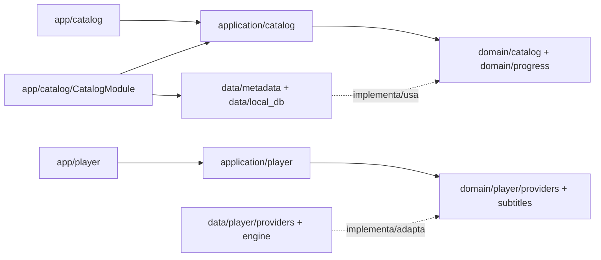

# Módulo `domain`

## Propósito y responsabilidad

Contiene identidad, modelos, reglas y contratos de negocio escritos en Dart puro. Debe poder analizarse y probarse sin Flutter UI, Linux, plugins, red ni base de datos.

## Módulos, archivos y contratos

| Módulo/archivo | Responsabilidad y contratos |
| --- | --- |
| `app_identity.dart` | Identidad estable de la app (`AppIdentity.name`), sin Flutter. |
| `catalog/anime_id.dart`, `anime_identity.dart`, `external_anime_id.dart` | Identidad UUID local, referencias externas y relaciones con evidencia explícita. |
| `catalog/library_entry.dart`, `library_repository.dart` | Estado local de pertenencia y puerto de biblioteca. |
| `catalog/metadata_provider.dart`, `provider_anime_metadata.dart`, `provider_result.dart`, `metadata_provenance.dart` | Contrato neutral de proveedores de metadatos, resultados tipados, procedencia y capacidades. |
| `catalog/anime_identity_repository.dart` | Puerto para crear, consultar y enlazar identidad local/crosswalk. |
| `catalog/anime_summary.dart`, `anime_catalog_repository.dart` | Contrato legacy de búsqueda usado por el adaptador AniList; no está consolidado con `MetadataProvider`. |
| `player/providers/playback_source.dart` | Anime/episodio de reproducción, provider ID, alternativa concreta, server y stream resuelto; modelos independientes de proveedores. |
| `player/providers/playback_provider_contract.dart` | Puerto de discovery/resolución, capacidades, cancelación cooperativa y errores tipados de proveedores de video. |
| `player/subtitles/` | Metadatos normalizados de pista, opciones de estilo y política explícita de hardsub; detalle en [`player/README.md`](player/README.md). |
| `auth/secure_credential_store.dart` | Puerto para CRUD de credenciales; adaptador concreto en `data/secure_storage`. |
| `progress/content_identity.dart` | `ContentId`, `EpisodeId` y `ProgressKey` tipados. |
| `progress/playback_progress.dart`, `playback_progress_repository.dart` | Modelo tipado de checkpoint y puerto por `ProgressKey`; adaptador en `data/local_db/drift_playback_progress_repository.dart`. |
| `progress/checkpoint_coordinator.dart` | Coordina checkpoints con reloj y writer inyectables; no crea timers. |
| `progress/progress_document.dart`, `progress/progress_repository.dart` | Formato legacy de payload opaco por identidad caller-owned; adaptador en `data/local_db/local_progress_repository.dart`. |
| `synchronization/sync_envelope.dart`, `sync_remote.dart` | Contrato de envío con envelope opaco; políticas de réplica pendientes. |

Los contratos legacy de AniList y progreso opaco se mantienen separados de los nuevos contratos neutrales y tipados. El primero preserva el cliente probado con loopback; el segundo conserva documentos previos sin reinterpretarlos. No fusionarlos ni migrarlos automáticamente sin una decisión y plan compatibles.

## Relaciones entre módulos

La aplicación coordina casos de uso mediante contratos/modelos del dominio. Los adaptadores implementan contratos; la composición selecciona implementaciones concretas. El manager de proveedores entrega una URI resuelta a la coordinación del player; no construye un motor ni importa media_kit. El dominio no importa Flutter, UI, SQL, Drift, Dio, plugins ni rutas de `app`, `application` o `data`.

## Dependencias permitidas y prohibidas

Puede depender de bibliotecas Dart puras justificadas y de otros contratos del dominio. No puede importar `dart:ui`, `dart:io`, `dart:ffi`, Flutter/UI, composición `app`, presentación, infraestructura, integraciones, plugins ni módulos de plataforma. Tampoco puede importar archivos fuera de `app/lib`; el checker rechaza symlinks bajo `app/lib` sin seguirlos. Evitar dependencias entre features que creen ciclos.

[`scripts/check_imports.dart`](../../../scripts/check_imports.dart) aplica estas reglas a todos los directorios `domain` bajo `app/lib`, incluidos `features/<feature>/domain`, y resuelve imports package y relativos. Las reglas y limitaciones están en [`scripts/README.md`](../../../scripts/README.md).

## Flujo y pruebas

Los modelos no ejecutan I/O. Las pruebas de contratos están en `app/test/domain/`, incluidas las contract tests de `PlaybackSourceProvider`; las pruebas de fallback/circuitos están en `app/test/application/`. Pruebas de persistencia y loopback viven en adaptadores. El flujo widget de catálogo usa `FakeMetadataProvider` y bloquea HTTP. Ejecutar el checker desde la raíz y `flutter test --no-pub` desde `app/`, con el SDK descrito en [`TESTING.md`](../../../TESTING.md).

## Portabilidad y límites

El módulo es Dart puro y reusable en plataformas futuras. Las implementaciones AniList, credenciales, metadatos y SQLite viven fuera del dominio. El catálogo local actual usa fake sintético; proveedores externos no están conectados. La búsqueda legacy AniList y el proveedor neutral coexisten hasta una decisión de consolidación.
