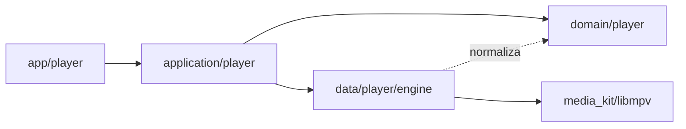

# Dominio del reproductor

## Propósito

Define datos y reglas del reproductor que no dependen de Flutter, libmpv,
GTK, red ni persistencia. Los contratos de proveedores describen alternativas
de fuente; los modelos de subtítulos describen capacidades y decisiones
observables. La implementación del motor permanece fuera del dominio.

## Estructura

| Ruta | Responsabilidad | Contratos y límites |
|---|---|---|
| `providers/playback_source.dart` | Anime/episodio, proveedor, fuente concreta, servidor y stream resuelto | Modelos normalizados; no contiene JSON de proveedor ni API del motor |
| `providers/playback_provider_contract.dart` | Discovery y resolución de streams | Capacidades, cancelación cooperativa, resultado y error tipados |
| `video_track_info.dart` | Metadatos observados de una pista de video de la fuente activa | ID efímero, resolución, códec, título y FPS/bitrate opcionales; no declara una escalera ABR |
| `subtitles/subtitle_track_info.dart` | Metadatos observables de una pista | ID de sesión, etiqueta, idioma/codec opcionales, tipo, default/selección |
| `subtitles/subtitle_style.dart` | Valores de presentación permitidos | Validación de tipo y rangos; no ejecuta ni persiste opciones mpv |
| `subtitles/hardsub_policy.dart` | Política de adjuntar subtítulos externos | Presente → bloqueado; ausente → permitido; desconocido → permitido con incertidumbre |
| `subtitles/external_subtitle_catalog.dart` | Query validada, candidato, resultado/errores tipados, descarga local y puertos de catálogo/loader | Modelos propios; incluye `parentImdbId`, parte multipart y `retryAfter`; nunca incluye DTO JSON, API key ni URL temporal |

## Cómo fluye la información

`application/player` coordina comandos y snapshots. El adaptador en
`data/player/engine` traduce la pista seleccionada y los valores de estilo a
media_kit/libmpv. La UI en `app/player` muestra la lista y envía intenciones al
coordinador. Este dominio no conoce `Player`, `VideoController`, rutas de
archivo ni proveedores concretos. IDs de pista son locales a la fuente/sesión;
no deben usarse como claves persistentes globales.



## Dependencias

Este módulo usa solo tipos del SDK Dart. No importa `dart:io`, Flutter,
`media_kit`, archivos de `app`, `application` o `data`. Validaciones que
requieren filesystem o motor corresponden a sus adaptadores y se repiten allí
si protegen una frontera externa.

## Pruebas

Los valores y política se prueban sin motor en
`app/test/domain/subtitle_policy_test.dart`; contratos de proveedores se
verifican en `app/test/domain/playback_provider_contract_test.dart`. Ejecutar
desde `app/` con la toolchain aislada del proyecto:

```bash
flutter test --no-pub test/domain/subtitle_policy_test.dart
flutter test --no-pub test/domain/playback_provider_contract_test.dart
flutter test --no-pub test/domain/external_subtitle_catalog_test.dart
flutter test --no-pub test/domain/video_track_info_test.dart
flutter test --no-pub test/data/opensubtitles/opensubtitles_client_test.dart
```

`ExternalSubtitleQuery` valida que exista identidad de búsqueda, limita título
y nombre de archivo, verifica IMDb/TMDB/hash, par temporada/episodio y códigos
de idioma; el IMDb del episodio y el IMDb padre son mutuamente excluyentes.
`ExternalSubtitleCandidate.partNumber/partCount` conservan la parte en
resultados multipart sin incluir tipos del proveedor. Los fallos tipados pueden
llevar `retryAfter` informado por el adaptador. `ExternalSubtitleDownload.uri` es el único valor de localización
devuelto por el puerto; application exige `file:` antes de pasarlo al loader.
`ExternalSubtitleLoader` es el puerto de aplicación para cargar ese archivo a
través del coordinator existente, no una API de motor nueva.

## Extensión

Añadir aquí solo datos/decisiones independientes de infraestructura. Si una
nueva opción exige un formato de proveedor o una propiedad nativa, conservar
un modelo neutral y traducirla en el adaptador. Para persistir estilos se
requiere decisión explícita sobre identidad de usuario, alcance y migración;
F2.6 mantiene el estado efímero.

## Audio y saltos

audio_track_info.dart mantiene metadatos opcionales y etiquetas de pistas embebidas. Los IDs son efímeros. skips/ contiene el rango validable por episodio/duración, el contrato de catálogo, las preferencias y la evidencia de filler. La automatización está deshabilitada de forma predeterminada. Recap y filler necesitan fuentes verificadas antes de automatizarse. Ver la [operación extendida](../../../../docs/player/operacion-extendida.md).

`VideoTrackInfo.label` forma una etiqueta a partir de dimensiones, bitrate y
códec que realmente informó media_kit; si faltan dimensiones, comunica que la
resolución no fue informada. Las etiquetas 360p/480p/720p/1080p/4K/8K solo se
usan para alturas coincidentes. El ID nativo es válido únicamente en la fuente
actual. Este modelo no descubre manifiestos ni garantiza soporte ABR.
