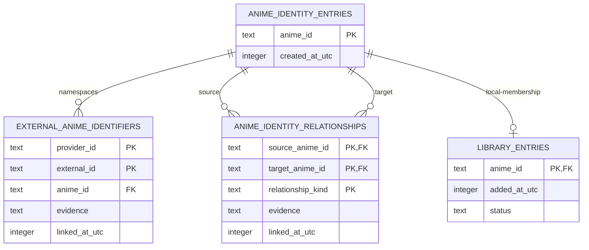

# Identidad interna de anime

## Clave

`AnimeId` es un valor opaco ASCII normalizado en minúsculas. Infraestructura genera UUID v4 con `Random.secure()` y persiste el prefijo `anime:` una sola vez. El título nunca forma la clave. Un dispositivo que sincronice en el futuro debe compartir el ID local original; no recrear IDs a partir del título o del ID de AniList.

Los IDs externos usan el par `(provider_id, external_id)`. El provider ID es un slug ASCII normalizado; el valor del proveedor se conserva (trim solamente), porque reglas de mayúsculas dependen de la fuente. SQLite tiene clave primaria compuesta para evitar colisiones entre proveedores y el mismo ID no puede redirigirse silenciosamente a otro `AnimeId`.

## Resolución y evidencia

`AnimeIdentityResolver` acepta referencias namespaced exactas y devuelve resuelto, no resuelto o ambiguo. Si dos referencias confiables apuntan a dos IDs internos distintos, devuelve ambiguo. Títulos similares no resuelven identidad. Asociación de ID externo requiere evidencia registrada: referencia cruzada confiable, referencia oficial verificada o confirmación explícita del propietario/usuario. `VerifiedExternalAnimeReference` expresa una afirmación del llamador, no una prueba criptográfica: solo un adaptador confiable o una confirmación explícita debe construirla. El resolver no puede comprobar la veracidad de esa evidencia por sí solo.

No se implementa aún ranking difuso ni UI de revisión. En un trabajo futuro, título normalizado, formato y año podrían limitar candidatos, pero jamás auto-fusionar. Una fuente sin IDs cruzados de confianza crea un registro local separado hasta revisión.

## Temporadas, relaciones y episodios

`AnimeRelationshipKind` diferencia `season`, `sequel`, `prequel`, `movie`, `special`, `ova` y `alternateVersion`. Relaciones son dirigidas, tienen evidencia y no permiten self-link. No se asignan episodios a una franquicia por similitud de título. `ProviderEpisodeMetadata` mantiene número de episodio/temporada y external ID del proveedor; esos números no son IDs canónicos entre fuentes.

Para unir progreso entre dispositivos se conserva el `AnimeId` local compartido. F1.10 sigue siendo independiente del proveedor: no se reescribe `ContentId` ni se migra automáticamente su namespace en esta misión.

## Drift

SQLite schema v6 adds the local tables and provisional `library_entries.status` (default `planned`, check: `planned/watching/completed`), FK cascade for deleting identity records, composite uniqueness and checks for empty IDs, evidence/kind enums and self-relations. These statuses are demo-only and not approved product rules. Library removal deletes only membership; it leaves identity and playback progress untouched. The UI supports adding an explicit fake-provider reference but no candidate review/merge/delete workflow.

## Legacy handling

The single AniList cache row from v3 and opaque progress documents from v2 remain in place. No automatic import is safe: old cache data may have provider retention constraints and old progress keys have no approved mapping to an anime identity. Migrations through v6 preserve old rows without interpreting or copying them. The new fake metadata is reconstructed from local synthetic fixtures and is not persisted.
