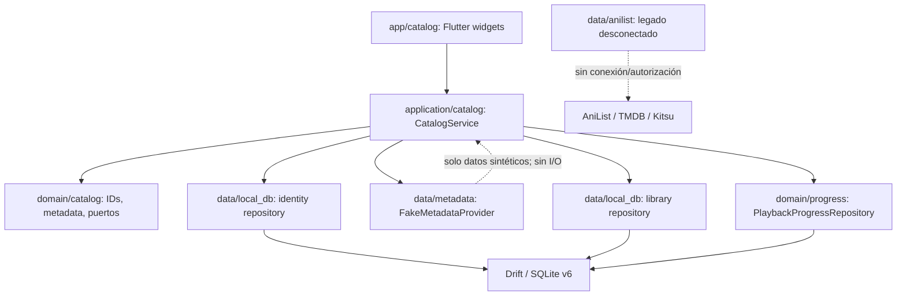
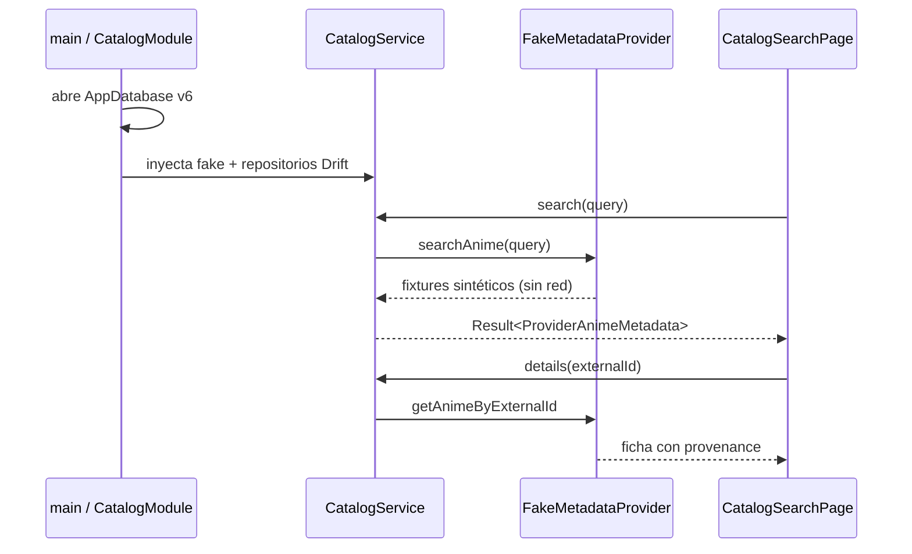
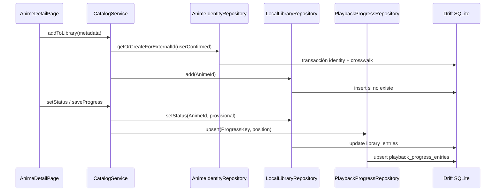

# Catálogo local-first: módulos y flujo actual

Esta integración respeta F1.3: núcleo Dart reusable, Fedora/Linux primero, adaptadores por necesidad. La app y paquete conservan el nombre AnimeApp/`anime_app`; “Kongroo” es el nombre de la misión.

## Reglas

- Abrir, buscar y usar biblioteca/progreso no requiere login ni servicios externos.
- `AnimeId` local es la identidad del usuario. Un `(providerId, externalId)` es solo referencia namespaced.
- Metadata es opcional y no se persiste en esta demo. El fake usa datos sintéticos, deterministas y sin I/O.
- Biblioteca y progreso son datos del usuario en SQLite; el progreso sigue en F1.10 y su repositorio existente.
- Metadata provider no autentica al usuario, no representa al proveedor de video y no controla reproducción.
- AniList/TMDB/Kitsu y OAuth no están conectados en el composition root.
- `VerifiedExternalAnimeReference` declara confianza del caller; no demuestra la validez de su evidencia.
- Estados `planned/watching/completed` y default `planned` son provisionales, no aprobados como reglas de producto. No hay transición por progreso.

## Capas

## Módulos y contratos

| Módulo | Responsabilidad | Estado |
| --- | --- | --- |
| `app/lib/domain/catalog/` | IDs, DTOs normalizados, resultados, registry, identidad y biblioteca | contratos implementados; ADR-A14 no aceptado |
| `app/lib/application/catalog/` | `CatalogService`, mapeo de errores y orquestación | implementado, sin Flutter/SQL/HTTP |
| `app/lib/data/metadata/` | provider fake determinista | activo solo para la demo local |
| `app/lib/data/local_db/` | identidad/crosswalk, membership, progreso y migraciones | SQLite/Drift v6; un repositorio por modelo existente |
| `app/lib/app/catalog/` | navegación, búsqueda, detalle, library status, editor de progreso demo | recorrido local funcional |
| `app/lib/data/anilist/` | cliente GraphQL y cache legacy | no conectado; elegibilidad y retención pendientes |
| `app/lib/data/secure_storage/` | adapter de credenciales | separado; sin OAuth en este recorrido |

Los README por módulo detallan archivos, errores, tests y portabilidad: [`domain/catalog`](../../app/lib/domain/catalog/README.md), [`application/catalog`](../../app/lib/application/catalog/README.md), [`data/metadata`](../../app/lib/data/metadata/README.md), [`data/local_db`](../../app/lib/data/local_db/README.md) y [`app/catalog`](../../app/lib/app/catalog/README.md).

## Flujo de inicio, consulta y detalle

## Flujo de alta, estado, progreso y reinicio

1. La persona pulsa Añadir; esa interacción crea/reutiliza una identidad por ID externo exacto con evidencia `userConfirmed`.
2. `DriftLocalLibraryRepository.add` comprueba la identidad y hace alta idempotente. La PK `anime_id` evita duplicados.
3. El selector escribe un estado provisional en la misma fila de membership.
4. El campo de segundos usa el `AnimeId` local como `ContentId` y `episode:1` como ID del episodio de demostración; el writer F1.10 persiste ms y duración desconocida.
5. Cerrar el módulo y volver a abrir el mismo SQLite restaura identity, crosswalk, membership/status y progreso. Metadata del fake se reconstruye desde sus fixtures.

## Drift v6 y migración

| Tabla | Propiedad | Clave/relación |
| --- | --- | --- |
| `anime_identity_entries` | AnimeApp | `anime_id` UUID local, `created_at_utc` |
| `external_anime_identifiers` | crosswalk | PK `(provider_id, external_id)`, FK identity, CHECK evidence |
| `anime_identity_relationships` | relación explícita | PK `(source,target,kind)`, dos FKs y CHECKs |
| `library_entries` | usuario | PK/FK `anime_id`, fecha y status provisional con CHECK/default |
| `playback_progress_entries` | usuario/F1.10 | clave local contenido/episodio; datos existentes preservados |
| `latest_anime_search` | cache legacy AniList | un slot, sin ampliación |
| `progress_documents` | JSON heredado | se conserva, sin importación automática |

La migración v5→v6 añade status; snapshots de v1, v2, v3, v4 y v5 se ejercitan con SQLite físico. `integrity_check` y `foreign_key_check` quedan cubiertos.

## Riesgos, fallos y no objetivos

- La prueba de red reemplaza `HttpOverrides` para fallar ante cualquier `HttpClient`.
- Si el fake no entrega metadata, la membership y progreso no se borran; se usa título fallback local.
- Un ID externo existente no se reasigna; similitud de título no fusiona identidades.
- La app instalada normalmente guarda datos app-owned en Application Support. Las pruebas/runtime de esta misión usan `.ai-local/` y no acceden a la DB personal.
- No hay provider real, cache durable de metadata, auth, sync de lista, reproductor, selección real de episodio ni datos externos almacenados.
- No se añadió Android, Android TV ni Windows. La elegibilidad, términos/retención, estados y política de episodios siguen pendientes de propietario.

Ver evidencia reproducible en [`catalog-testing.md`](../development/catalog-testing.md), escenarios en [`catalog-failure-scenarios.md`](catalog-failure-scenarios.md) y estado de aprobación en [`ADR-A14`](../adr/additional/ADR-A14-catalog-providers-identity.md).
