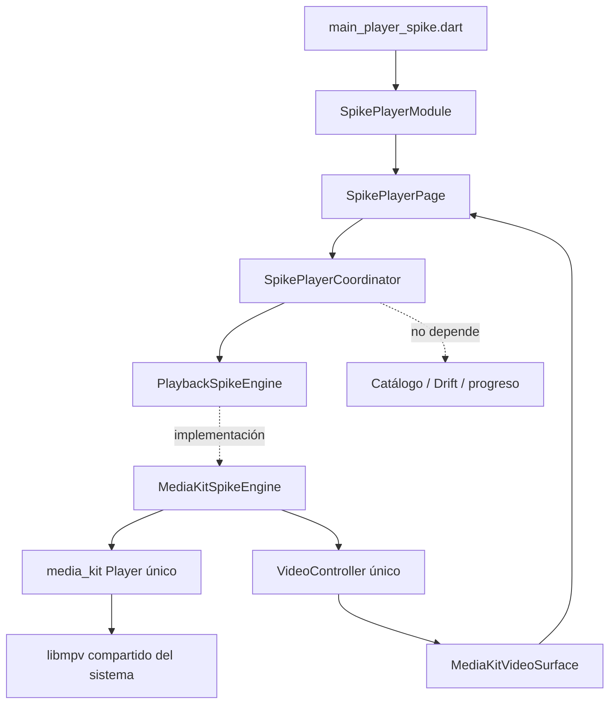

# F2.2 — Spike de reproducción Linux

> Corte histórico anterior a las correcciones de auditoría v2. El estado actual, incluidas las pruebas y limitaciones posteriores, está en [F2.2-spike-report-v2.md](F2.2-spike-report-v2.md); este documento se conserva como evidencia del corte previo.

> **Estado posterior:** F2.2 fue aceptada y cerrada por el propietario el 2026-11-10. Ver la sección de aceptación en el [informe vigente v2](F2.2-spike-report-v2.md). La falta de test automatizado completo del lifecycle nativo de VideoController queda registrada como limitación.

Fecha de ejecución: 2026-11-09
Estado: correcciones aplicadas y reevaluación técnica independiente completada; aceptación del propietario pendiente
Alcance: fixture local sintético, Fedora/Linux, reproductor aislado y opt-in

## Resultado

Se integró `media_kit` con libmpv del sistema detrás de un puerto Dart temporal. La integración nativa abrió y decodificó un MP4 sintético real: la posición avanzó, la pausa quedó estable y un seek desde una posición de partida inferior a 2 s se verificó por un evento entre 5.5 y 7 s tras solicitar el destino 6 s. Stop/dispose finalizaron sin error. La prueba usa el adaptador real, no un fake. Pruebas separadas con fake cubren la coordinación y el orden de comandos.

La aplicación del producto no cambia de entrada: `app/lib/main.dart`, `AnimeApp`, catálogo, Drift, progreso y navegación no se conectan a este spike. Para probarlo manualmente se selecciona explícitamente `lib/main_player_spike.dart`.

## Arquitectura efectivamente implementada



| Módulo | Archivos | Responsabilidad/contrato | Dependencias y conexión |
| --- | --- | --- | --- |
| Aplicación | `app/lib/application/player/playback_spike_contract.dart`, `spike_player_coordinator.dart` | Puerto async mínimo; snapshot inmutable; serializa initialize/open/play/pause/seek/stop/dispose y valida URI/seek | Solo Dart; no importa Flutter, Drift ni media_kit. Recibe puerto por constructor |
| Adaptador | `app/lib/data/player/engine/media_kit_spike_engine.dart`, `active_player_lease.dart` | Traduce comandos a `Player`, transforma streams a snapshots y reserva el único Player hasta completar la limpieza | `media_kit`, `media_kit_video`, libmpv Linux. Implementa el puerto de aplicación |
| Presentación | `app/lib/app/player/spike_player_page.dart`, `media_kit_video_surface.dart` | Controles Play/Pause/Stop/seek, estado y salida de video | Flutter + `media_kit_video` para el widget `Video`; consume coordinator y controller ya creado |
| Composición | `app/lib/app/player/spike_player_module.dart`, `app/lib/main_player_spike.dart` | Construye un grafo y abre fixture por entrypoint separado | Es la única selección del adaptador; no altera `main.dart` del producto |
| Pruebas | `app/test/player/active_player_lease_test.dart`, `playback_spike_snapshot_test.dart`, `spike_player_coordinator_test.dart`, `media_kit_spike_integration_test.dart` | Concurrencia/reintento de cleanup, política sticky de error, fake coordinador y prueba contra adaptador/libmpv real | Flutter test, fixture generado bajo `.ai-local` |

El puerto se llama `PlaybackSpikeEngine` deliberadamente: no reemplaza el contrato definitivo previsto en F2.5. El adaptador llama `MediaKit.ensureInitialized()` antes de crear `Player`; `ActivePlayerLease` rechaza una segunda adquisición hasta completar toda la limpieza. Los callers simultáneos de release reciben el mismo Future y siempre ejecutan el callback original del propietario del lease. Si falla una etapa Dart reintentable, el lease sigue reservado y el cleanup continúa en otro intento. El dispose nativo de `Player` es de un solo intento: en media_kit 1.2.6 la implementación Linux marca el Player como dispuesto antes de completar toda la liberación; si su Future falla, el adaptador conserva el lease en cuarentena, cierra las corrientes Dart posibles y nunca llama dispose otra vez. En ese caso no se permite crear otra instancia en el mismo proceso; se requiere reiniciarlo. La prueba determinista mantiene el callback de cleanup suspendido para verificar slot ocupado y Future compartido. La composición entrega el mismo controller que pertenece a ese Player a la superficie UI. El coordinator cancela la suscripción y dispone el adaptador; el adaptador cancela sus streams, dispone el Player y cierra su stream. El coordinator cierra su stream público aun si el motor lanza; propaga el error y deja solicitar la continuación de cleanup sin aceptar nuevos comandos.

## Entorno y medio de prueba

- Fedora 44, x86_64; Flutter `3.50.0-0.4.pre`; Dart `3.14.0-315.3.beta`.
- `pkg-config mpv`: 2.5.0; paquete RPM observado: `mpv-libs-0.41.0-5.fc44.x86_64`; biblioteca `/lib64/libmpv.so.2`.
- Fixture generado localmente, 8 s, video MPEG-4 320×180 a 24 fps y audio AAC 48 kHz. Está en `.ai-local/f2.2/fixtures/spike.mp4`, excluido del producto y de Git. No se usa contenido con copyright ni una fuente de red.
- Dependencias directas fijadas por lockfile: `media_kit 1.2.6`, `media_kit_video 2.0.1`, `media_kit_libs_video 1.0.7`; `media_kit_libs_linux 1.2.1` se resuelve transitivamente.

## Pruebas y observaciones

### Criterios de entrega

| Criterio | Estado | Evidencia |
| --- | --- | --- |
| El MP4 se reproduce realmente en Fedora | Cumplido en motor nativo; evidencia visual pendiente | libmpv real abre el fixture y avanza posición; captura no confirmó un frame visible |
| Open, play, pause y seek funcionan | Cumplido en test nativo; salida visual pendiente | Prueba nativa observa avance, pausa estable y transición desde <2 s a 5.5–7 s tras seek a 6 s |
| Existe una sola instancia activa del motor | Corrección cubierta por prueba determinista y test nativo | Lease no libera slot hasta completar cleanup y comparte Future entre releases concurrentes |
| Stop y dispose están probados | Cumplido con ruta de fallo/retry cubierta por fake | Stop y doble dispose nativo; fake verifica dispose concurrente, fallo y retry |
| Archivos en capas correctas | Cumplido | Contrato/coordinador en application, plugin en data, UI en app |
| README detallado por módulo | Cumplido | README de application/player, data/player/engine y app/player |
| Pruebas libmpv real además de fakes | Cumplido | Suite fake de coordinación y test nativo real |
| No se modificó catálogo ni Drift | Cumplido para este cambio F2.2 | Los archivos F2.2 se limitan a dependencias multimedia, player, pruebas y documentación; cambios concurrentes previos del catálogo permanecen aparte |
| Compila y pasa CI | Cumplido con SDK beta aislado | Flutter analyze, 73 Flutter tests, `scripts/ci.sh` y Linux release build; resultados actuales en [reevaluación de auditoría](../ai-system/audits/F2.2-audit-reevaluation-2026-11-09.md) |

| Comprobación | Resultado | Qué demuestra |
| --- | --- | --- |
| Integración `media_kit_spike_integration_test.dart` | Pasa con Flutter test y libmpv real | Open, avance >700 ms, pausa estable, seek 6 s desde inicio <2 s, ausencia de error, stop y doble dispose |
| Unitarias `test/player` | Pasa con fake más adaptador real | 11 pruebas: FIFO, URI/seek, cleanup retrasado, release concurrente, callback original, retry después de fallo, cierre del stream, error sticky y libmpv real |
| `flutter run -d linux -t lib/main_player_spike.dart` | Bundle Linux debug compila; proceso Linux se inicia y carga el plugin | Entry point y runner se pueden construir/arrancar en el entorno |
| Captura de escritorio durante la sesión | No muestra la ventana del spike; la captura recuperada es Codex | No constituye evidencia de primer frame/presentación visual |

La prueba headless verifica decodificación y control nativo, no la presentación de una textura en el compositor. El proceso de aplicación abrió conexiones Wayland/DMA-BUF, pero no se pudo identificar una ventana visible del spike en la sesión capturada. Por ello, el criterio “MP4 visible reproduciéndose en Fedora” queda parcialmente verificado: la reproducción nativa sí, la salida visual en pantalla aún necesita una revisión manual en una sesión visible. Las pruebas de leases son deterministas y aíslan el gate de recursos; el test de integración real confirma el adaptador real, aunque no inyecta un fallo dentro del dispose nativo. La reauditoría detectó que ese fallo puede ser de un solo intento en media_kit; el adaptador ahora retiene el lease en cuarentena para no intentar liberar otra vez ni permitir un segundo Player con estado nativo incierto. El proceso debe reiniciarse si ocurre.

## Comandos reproducibles

Desde la raíz del proyecto, con el SDK beta aislado ya registrado en la memoria:

```bash
cd app
PUB_CACHE=../.ai-local/pub-cache ../.ai-local/toolchains/flutter/bin/flutter pub get
PUB_CACHE=../.ai-local/pub-cache ../.ai-local/toolchains/flutter/bin/flutter test --no-pub test/player/spike_player_coordinator_test.dart
PUB_CACHE=../.ai-local/pub-cache ../.ai-local/toolchains/flutter/bin/flutter test --no-pub test/player/media_kit_spike_integration_test.dart
PUB_CACHE=../.ai-local/pub-cache ../.ai-local/toolchains/flutter/bin/flutter run -d linux -t lib/main_player_spike.dart
```

La ruta de fixture es relativa a la app y apunta al archivo local de `.ai-local/f2.2/fixtures`. La integración no debe ejecutarse sin la biblioteca libmpv compatible presente. Para salir, cerrar la ventana y comprobar la terminación del proceso.

## Licencias, recursos y límites

La documentación oficial versionada de `media_kit 1.2.6` exige esperar `await player.dispose()` para liberar recursos y describe `Player.dispose()` como `Future<void>`. La implementación local bloqueada en esa versión delega a `PlatformPlayer.dispose()`, cuya ruta Linux/compartida cierra streams y espera callbacks de release. Esto confirma que la ranura no debe liberarse antes de completar el Future; no establece una garantía upstream sobre instancia global única, que es una política de este adaptador. Referencias: [guía/version 1.2.6](https://pub.dev/packages/media_kit/versions/1.2.6), [API Player 1.2.6](https://pub.dev/documentation/media_kit/1.2.6/media_kit/Player-class.html), consulta 2026-11-09.

Los paquetes Dart se resuelven en `pubspec.lock`; esto no basta para identificar licencias, codecs y avisos de los binarios del sistema o una futura imagen Flatpak. mpv/libmpv y sus dependencias (incluido FFmpeg) tienen condiciones que dependen del build. La publicación requiere inventario exacto del artefacto y avisos según F5; F2.2 no redistribuye libmpv ni cambia el sistema.

No se midieron CPU, memoria sostenida, fugas, primer frame de compositor, codecs adicionales ni rendimiento del equipo objetivo de 4 GB. No se habilitaron subtítulos, cambio de fuentes, seek interactivo robusto, persistencia de progreso, reproducción remota, autoselección de episodios ni controles de producto. El slider envía seeks en cada actualización y solo sirve como control de spike.

## Próximas decisiones

1. Confirmar manualmente la superficie visible y el primer frame en sesión Fedora visible; conservar evidencia dentro de `docs/player/` solo si se captura correctamente.
2. Completar análisis de licencias/artefactos al preparar distribución.
3. Esperar autorización separada antes de F2.3; el spike no define contrato final ni política de integración con progreso.
